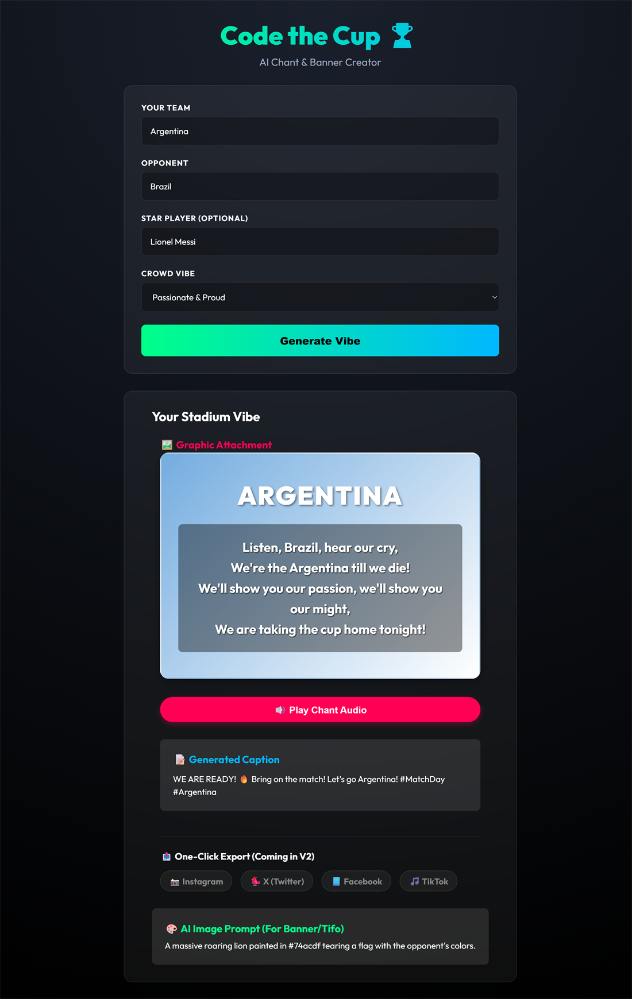

# MatchDay AI — Code the Cup Hackathon 🏆

<p align="center">
  
</p>

## Overview
This repository contains the MVP for the **Code the Cup Hackathon** (Google GDG / Build with AI). The application is an AI-powered Social Media Asset Generator built specifically for football (soccer) fans and community managers to generate match-day hype content.

## The Challenge
**Challenge #5:** An AI tool that generates custom fan chants, banners, or social posts for a chosen team, personalized with player names and country flair.

This app tackles every requirement by generating:
1. **A Custom Chant**: Personalized to the team, the opponent, and a specified star player.
2. **A Social Media Caption**: A highly engaging, viral-ready post written in the team's native language.
3. **An AI Image Prompt**: A detailed prompt for a stadium banner (Tifo) that can be fed into an image generator to create the final visual asset.

## The Approach: Solo with Antigravity
Instead of joining a traditional team, I chose to enter this hackathon as a **Solo Developer** pair-programming exclusively with **Antigravity** (Google Deepmind's advanced agentic coding assistant). 

The goal was to test the absolute limits of what a single developer could architect, design, and build in a highly constrained environment by leveraging agentic AI.

## Constraints
Building this MVP was a race against the clock and infrastructure limits:
* **Time Limit:** 90 minutes to ideate, build, debug, and polish.
* **Model Access:** No free-tier access to Google's Nano Banana (Gemini Flash Image) or Veo models for direct media generation.
* **Quota Limits:** Working on a fresh free-tier API key meant constantly brushing up against Requests Per Minute (RPM) and Requests Per Day (RPD) limits across different Gemini models.

## Issues Faced & How We Overcame Them
* **API Rate Limiting:** Midway through development, we hit the quota limit for the Gemini 2.5 Flash model. We overcame this by dynamically swapping to Gemini 3.5 Flash and Gemini 3.1 Flash Lite to conserve our remaining requests for the final pitch.
* **Model Hallucinations:** When testing with mixed-nationality inputs (e.g., an English team playing a Spanish team with an Argentine player), the lighter AI models hallucinated and outputted the chant in French. We fixed this by injecting strict guardrails and hardcoded language examples into the system prompt.
* **Image Generation Blockers:** Because we didn't have access to the Gemini Image models on the free tier, we pivoted the architecture. Instead of returning a broken image, the AI acts as an Art Director, generating a highly descriptive "AI Image Prompt" that users can copy/paste into their own image generation tools (like Midjourney or AI Studio).
* **UI/UX Pivot:** We initially designed the app to look like a mock Twitter feed. However, we realized community managers need *assets*, not mockups. We quickly pivoted the UI into a clean "Building Blocks" layout so users can easily copy the text and image prompts to post on their actual accounts.

## Backend Resilience & Architecture
Because live demos are notorious for failing, we engineered a bulletproof **3-Layer Fallback Architecture** to guarantee 100% uptime during the 3-minute pitch:
1. **Primary Layer:** Attempts to call `gemini-3.1-flash-lite` for lightning-fast, quota-friendly generations.
2. **Secondary Layer:** If the Lite model fails or hits a rate limit, the app automatically catches the error and falls back to `gemini-3.5-flash` using our reserved presentation quota.
3. **Emergency Hardcoded Layer:** If the network completely drops or all API quotas are exhausted, the system falls back to a highly polished, hardcoded emergency payload. 

No matter what happens, the app never crashes—it always delivers the hype!

## Getting Started

1. **Clone the repository:**
   ```bash
   git clone https://github.com/syedn44/code_the_cup_hackathon.git
   cd code_the_cup_hackathon
   ```

2. **Install dependencies:**
   ```bash
   npm install
   ```

3. **Configure your Gemini API key:**
   Copy `.env.example` to `.env` and set your API key from [Google AI Studio](https://aistudio.google.com/):
   ```bash
   cp .env.example .env
   ```
   Add your key in `.env`:
   ```env
   VITE_GEMINI_API_KEY=your_gemini_api_key_here
   ```

4. **Run the app:**
   ```bash
   npm run dev
   ```
